# Aurora HA Failover

An Aurora PostgreSQL cluster in one Region, a small Fastify app on ECS in front of it, and a
prober that keeps writing through three client setups while the writer is broken on purpose. The
point is a measured answer to one question: when Aurora fails over inside a Region, how long does
a Node.js app see errors, and does RDS Proxy shorten that?



## What is built so far

| Milestone | Scope                                   | State |
| --------- | --------------------------------------- | ----- |
| M0        | Network, Aurora cluster, managed secret | Done  |
| M1        | Web app, page, ECS service, ALB         | Done  |
| M2        | RDS Proxy, prober, timeline             | Done  |
| M3        | Failure scenario targets                | Done  |
| M4        | Test day: 11 runs, results, destroy     | Done  |

## Cost

This is not free-tier. Three `db.t4g.medium` instances, a NAT gateway, an ALB and RDS Proxy come
to about $0.55 an hour in eu-central-1, so about $13 for a day left running. Run `make destroy`
when you are done.

## Prerequisites

- Node 22 and pnpm
- Terraform 1.10 or later
- AWS CLI with credentials for the target account
- Docker, for the arm64 image
- An S3 bucket for Terraform state. `infra/envs/dev/backend.tf` names the one used here; change it
  to yours.

## Commands

The Makefile is the command surface. `make` lists everything.

```bash
make install
make tf-init
make up
make url
make status
make destroy
```

`make up` is the first deploy. The web service cannot start before its image exists, so it
creates the ECR repository alone, pushes the image, then applies everything else. Afterwards,
`make deploy` applies infrastructure changes and `make redeploy` ships a new image.

The ALB admits one address: your public IP when you last applied. On a new network, run
`make deploy` again.

`make health` prints each heartbeat lane's last sample and ticks in flight.

`make s1` to `make s4` run one failure scenario each: check the cluster is healthy, break it, wait for
recovery, write the run to `results/`, print a summary. `LABEL=dry` marks a rehearsal. After
`make s3`, run `make restore` to re-create the deleted instance. `make summary` prints every run
and the median table.

`make status` prints the current writer and, for every instance, its AZ, failover tier and state.

## Shortcuts

Fine for a cluster that lives for one day. Do not copy them into production unread.

- HTTP on the ALB, limited to one IP.
- One NAT gateway, in AZ `a`. Losing that AZ cuts the tasks' outbound path.
- The app connects as the master user from the RDS-managed secret.
- No deletion protection, no final snapshot, one day of backup retention.
- Minor version upgrades are off, so maintenance cannot start a failover on the test day.
