# Enterprise RAG Authz



A document Q&A system for two fictional companies sharing one OpenSearch index. Users log in, ask
questions and get cited answers built only from documents they may read. Company admins upload and
delete files for their own company without gaining read access to them in chat.

## What is built so far

| Milestone | Scope                                                    | State       |
| --------- | -------------------------------------------------------- | ----------- |
| M0        | Tooling, access rules, chunker, unit tests, React shell  | Done        |
| M1        | Network, OpenSearch, DynamoDB, S3, SQS, Cognito          | Done |
| M2        | Ingestion, admin API, corpus                             | Done |
| M3        | Question path: retrieval, rerank, Guardrails, streaming  | Done |
| M4        | React app and CloudFront                                 | Done |
| M5        | Metrics, alarms, deployed test suites                    | Done |
| M6        | Test day, results, destroy                               | Results done, stack up |

## Prerequisites

- Python 3.13 and `uv`
- Node 22 and pnpm
- Docker, for the arm64 images

## Commands

The Makefile is the command surface. `make` lists everything.

```bash
make install
make check
make ecr
make push
make deploy
make m1-check
make seed
make web-deploy
make eval-documents
make destroy
```

`make check` needs no AWS credentials and deploys nothing. On a first deploy, `make ecr` and `make push` must run before `make deploy`, because the API and the Lambda need their images to exist.

`make deploy` needs Terraform 1.10 or later, AWS credentials, and an S3 bucket for state. `infra/envs/dev/backend.tf` names the one used here; change it to yours.

## Cost

This is not free-tier. OpenSearch, the NAT gateway and the Bedrock endpoints bill by the hour whether you use them or not, at about $5.75 a day once the API is deployed. Run `make destroy` when you are done.

## Where things live

| Folder       | What it holds                                                     |
| ------------ | ----------------------------------------------------------------- |
| `api/`       | FastAPI app                                                       |
| `functions/` | Lambdas, one folder each                                          |
| `shared/`    | Code both use: access rules, index schema, query builder, chunker |
| `web/`       | React app                                                         |
| `infra/`     | Terraform                                                         |
| `scripts/`   | Demo accounts and checks run from a laptop                        |
| `eval/`      | Test suites run against the deployed stack                        |
| `corpus/`    | Generated documents                                               |

## Where the access rules live

[`shared/erag/authz.py`](shared/erag/authz.py) holds the filter builder and the recheck. It imports nothing
from AWS, so the rules can be read and tested on their own.
